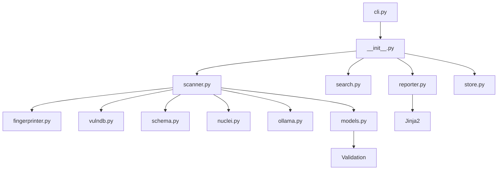

<!-- header:start -->
<div align="center">


<a href="#-quick-start"></a>

<a href="LICENSE"></a>

<a href="https://github.com/ajendras/php-fossil/stargazers"></a>
<a href="https://github.com/ajendras/php-fossil/actions/workflows/ci.yml"></a>

<a href="CONTRIBUTING.md"></a>

**Discovers legacy PHP sites via search dorks, fingerprints old versions, maps vulns, extracts schemas and builds prioritized security lists.**

[✨ Features](#-features) • [⚡ Quick start](#-quick-start) • [🧰 Usage](#-usage) • [🧩 Architecture](#-architecture) • [📍 Roadmap](#-roadmap) • [🤝 Contributing](#-contributing)

</div>
<!-- header:end -->

## ✨ Why PHP Fossil?

Countless sites still run unsupported PHP versions (pre-8.1) riddled with known CVEs, yet lack a focused open-source tool. Existing scanners are either too generic or ignore search-driven discovery and schema leakage. PHP Fossil is built for authorized pentesters, bug-bounty hunters and security teams that maintain large site inventories.

- **Targeted discovery** — `generate_dorks()` produces precise Google/Bing/Shodan dorks for specific PHP versions and signatures
- **Accurate fingerprinting** — Multi-vector detection via `detect_from_headers()`, `detect_from_body()`, `detect_from_phpinfo()` and error-page fallbacks
- **Built-in intelligence** — Embedded VulnDB with 180+ CVEs, severity ratings, fix versions and references via `get_vulns_for_version()`
- **Actionable output** — `ScanResult` objects feed rich terminal tables, interactive HTML reports, JSON exports and prioritized at-risk lists

## 🎬 Demo

<p align="center"></p>

## 🚀 Features

<table>
<tr>
<td>
🔎 <b>Dork Generator</b><br>
Produces ready-to-use Google/Bing/Shodan dorks for any PHP version
</td>
<td>
🕵️ <b>Version Fingerprint</b><br>
Detects exact version from headers, body, phpinfo() and error pages
</td>
<td>
🛡️ <b>Vuln Database</b><br>
Maps versions to embedded CVEs with severity and exploit links
</td>
</tr>
<tr>
<td>
📊 <b>Schema Extractor</b><br>
Locates exposed .sql files and parses tables/columns with `parse_sql_dump()`
</td>
<td>
🔬 <b>Nuclei Integration</b><br>
Deeper exploit validation via ProjectDiscovery Nuclei templates for confirmed RCE/LFI on legacy PHP
</td>
<td>
📋 <b>List Manager</b><br>
Saves, filters and exports at-risk domains via the `list` CLI command
</td>
</tr>
<tr>
<td>
📑 <b>Rich Reports</b><br>
Terminal tables and beautiful HTML reports via `ReportGenerator`
</td>
<td>
⚡ <b>Async Scanner</b><br>
Concurrent, rate-limited scans with `scan_targets()` and configurable limits
</td>
<td>
🧠 <b>LLM Summaries</b><br>
Local Ollama generates executive summaries, risk ratings and remediation advice
</td>
</tr>
</table>

**Persistent History** — Every scan is automatically saved to a local SQLite database (`~/.phpfossil/history.db`). Review and query past results with the `history` CLI command or `get_historical_results()`.

## 📦 Installation

Requires **Python 3.11+**. All dependencies are declared in `pyproject.toml`.

```bash
pip install php-fossil
```

Or install from source:

```bash
git clone https://github.com/ajendras/php-fossil.git
cd php-fossil
pip install -e ".[dev]"
```

The CLI is automatically installed as the `php-fossil` command.

**Nuclei requirement (optional):** For exploit validation run `go install -v github.com/projectdiscovery/nuclei/v3/cmd/nuclei@latest` and ensure `nuclei` is in your PATH.

**Ollama requirement (optional):** For LLM summaries run `ollama serve` and pull a model (`ollama pull llama3`).

## ⚡ Quick start

```python
import asyncio
from phpfossil import scan_targets, generate_report, store_results, get_historical_results, validate_with_nuclei, generate_summary

results = asyncio.run(scan_targets(
    ["https://httpbin.org", "http://example.com"],
    config={
        "max_concurrency": 10,
        "timeout": 15,
        "use_nuclei": True,
        "use_ollama": True,
        "ollama_model": "llama3"
    }
))

# results are automatically persisted to SQLite
store_results(results)

generate_report(results, output_format="terminal")
generate_report(results, output_format="html", output_path="report.html")

# retrieve historical scans
history = get_historical_results(limit=5)

# standalone LLM summary
summary = generate_summary(results)
print(summary)
```

## 🧰 Usage

**Generate dorks for a specific version:**

```bash
php-fossil dorks --version 7.4 --count 20 --save dorks.txt
```

**Scan targets from a file with Nuclei and Ollama:**

```bash
php-fossil scan -f targets.txt --concurrency 25 --timeout 10 --nuclei --ollama --html report.html
```

**View historical scans from the persistent store:**

```bash
php-fossil history --limit 20
php-fossil history --url example.com
php-fossil history --db /path/to/custom.db
```

**Re-generate reports from saved JSON:**

```bash
php-fossil report phpfossil-results.json --html latest.html
```

**Manage an at-risk list:**

```bash
php-fossil list add --url https://legacy.example.com --version 5.6.40
php-fossil list show
```

<details><summary>Library API usage (advanced)</summary>

```python
import asyncio
from phpfossil import generate_dorks, scan_targets, generate_report, get_historical_results, validate_with_nuclei, generate_summary
from phpfossil.models import ScanResult, Vulnerability

# Custom dork generation
dorks = generate_dorks("8.0", count=12)
print(dorks[0])  # e.g. intitle:"phpinfo()" "PHP Version 8.0"

# Direct scan with Nuclei + Ollama
results: list[ScanResult] = asyncio.run(scan_targets(
    ["https://httpbin.org"],
    config={"use_nuclei": True, "use_ollama": True, "ollama_model": "llama3"}
))
for r in results:
    if r.is_vulnerable():
        print(f"{r.url} → {r.php_version} ({len(r.vulns)} vulns, {len(r.nuclei_findings)} confirmed)")
        for v in r.vulns:
            print(f"  • {v.cve} ({v.severity})")
    for f in r.nuclei_findings:
        print(f"    Nuclei confirmed: {f.name} ({f.severity})")

if results and results[0].llm_summary:
    print("\n=== LLM Summary ===\n")
    print(results[0].llm_summary)

# Standalone summary
summary = generate_summary(results, model="llama3")
print(summary)
```

</details>

<details><summary>Extending the fingerprinter</summary>

```python
from phpfossil.fingerprinter import detect_php_version

# Combine multiple sources
version = detect_php_version(
    headers={"X-Powered-By": "PHP/7.4.33"},
    body="<h1>PHP Version 7.4.33</h1>",
    phpinfo_content="PHP Version 7.4.33"
)
print(version)  # 7.4.33
```

</details>

## 🔧 Configuration

| Option            | Default | Description                                      |
|-------------------|---------|--------------------------------------------------|
| max_concurrency   | 20      | Maximum simultaneous HTTP requests (capped at 50) |
| timeout           | 12      | HTTP request timeout in seconds                  |
| proxies           | []      | Optional list of proxy URLs for rotating requests |
| use_nuclei        | false   | Enable Nuclei for deeper exploit validation (requires `nuclei` binary in PATH) |
| use_ollama        | false   | Enable local Ollama LLM for natural-language summaries of issues (requires Ollama running with a model like llama3) |
| ollama_model      | llama3  | Ollama model name to use for summarization |
| db_path           | ~/.phpfossil/history.db | Path to persistent SQLite database for scan history |

These are passed via the `config` dict to `scan_targets()` or via CLI flags `--concurrency`, `--timeout`, `--nuclei` and `--ollama`. Proxy rotation and Nuclei are currently only available through the library API and the new `--nuclei` flag; future CLI enhancements will expand options. The SQLite store is used automatically by `scan` and `history` commands. Ollama summaries appear in terminal reports and the HTML overview when enabled.

## 🧩 Architecture



PHP Fossil follows a clean, modular architecture. The public API in `__init__.py` (`scan_targets`, `generate_dorks`, `generate_report`, `store_results`, `get_historical_results`, `validate_with_nuclei`, `generate_summary`) orchestrates everything. `AsyncScanner` uses a rate-limited `httpx.AsyncClient` and delegates to specialized modules for fingerprinting, vulnerability lookup, schema extraction, Nuclei validation, Ollama summarization and reporting. All data flows through validated Pydantic models (`ScanResult`, `Vulnerability`, `SchemaResult`, `ExposedFile`, `NucleiFinding`). Scans are automatically persisted to SQLite via the `Store`.

## 📁 Project structure

```text
src/phpfossil/
├── __init__.py          # Public API, models, scan_targets, generate_dorks, generate_report
├── cli.py               # Typer commands: scan, dorks, report, list, history
├── models.py            # Pydantic models (ScanResult, Vulnerability, SchemaResult, ExposedFile, NucleiFinding)
├── scanner.py           # Async scanning, _probe_target, rate limiting, proxy rotation, Nuclei/Ollama post-processing
├── fingerprinter.py     # detect_from_headers, detect_from_body, detect_from_phpinfo, detect_from_error_page
├── vulndb.py            # _get_embedded_vulndb, get_vulns_for_version
├── schema.py            # parse_sql_dump, locate_sql_urls
├── nuclei.py            # validate_with_nuclei, Nuclei template mapping, subprocess runner
├── ollama.py            # Local LLM summaries via Ollama REST API (no extra deps)
├── search.py            # DorkGenerator with 18 templates
├── reporter.py          # ReportGenerator.to_terminal, to_html + default Jinja template
├── store.py             # Persistent SQLite store with automatic history tracking
└── pyproject.toml       # Dependencies, console script entrypoint

examples/
├── scan_targets.py      # Runnable library API demo
└── custom_dorks.py      # Extending DorkGenerator

tests/
├── test_scanner.py      # Tests for fingerprinting, async mocks, exposed files, Store, Nuclei, Ollama
├── test_vulndb.py       # CVE mapping, severity, EOL checks
├── test_fingerprinter_cms.py  # New tests for CMS version detection
```

## 🧪 Testing

First install with test dependencies:

```bash
pip install -e ".[dev]"
pytest
```

Tests cover `detect_php_version` accuracy, `scan_targets` with `pytest-httpx` mocks, `parse_sql_dump`, VulnDB lookup, CLI commands, JSON serialization of `ScanResult` objects, the new persistent `Store`, mocked Nuclei validation and the Ollama summarizer (with mocked HTTP calls to localhost:11434).

## 📍 Roadmap

<!-- roadmap:start -->
- [x] **v0.1.0** — first release: Dork Generator, Version Fingerprint, Vuln Database, Schema Extractor
- [x] Add proxy rotation and residential proxy support
- [x] Persistent SQLite store for historical scan results
- [x] WordPress/Joomla/Laravel specific version fingerprinting
- [x] Integration with Nuclei for deeper exploit validation
- [x] Local LLM (Ollama) summaries of discovered issues
- [ ] Interactive terminal TUI with textual for live scanning
- [ ] GitHub Action for scheduled scans of your own domains
- [ ] CSV export compatible with bug-bounty platforms
- [ ] Shodan and Censys API modules for passive discovery
- [ ] Community fingerprint repository loader
- [ ] Severity scoring that factors in exposed schema sensitivity
- [ ] Dark-mode HTML report with sortable vulnerability table

> 🤖 This roadmap is worked through continuously — ideas and PRs welcome!
<!-- roadmap:end -->

## 🤝 Contributing

We love community contributions! Whether it's a new fingerprint technique, additional CVE data, improved HTML templates, or better dork templates — every PR helps.

Please read [CONTRIBUTING.md](CONTRIBUTING.md) and follow our [CODE_OF_CONDUCT.md](CODE_OF_CONDUCT.md). Issues labeled **good first issue** are perfect for your first PR. Join us in making legacy PHP discovery faster and safer.

## 📄 License

This project is licensed under the **MIT License**. See [LICENSE](LICENSE) for details.

<!-- footer:start -->
<div align="center">

### ⭐ Star history

<a href="https://star-history.com/#ajendras/php-fossil&Date"></a>

If **PHP Fossil** saves you time, a ⭐ helps others find it.

Made with ❤️ by [Ajendra](https://ajendra.info)


</div>
<!-- footer:end -->
